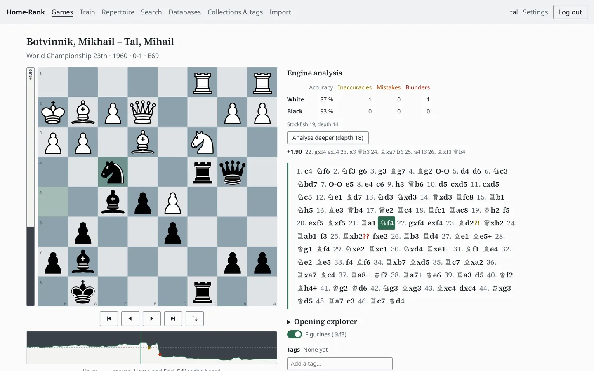
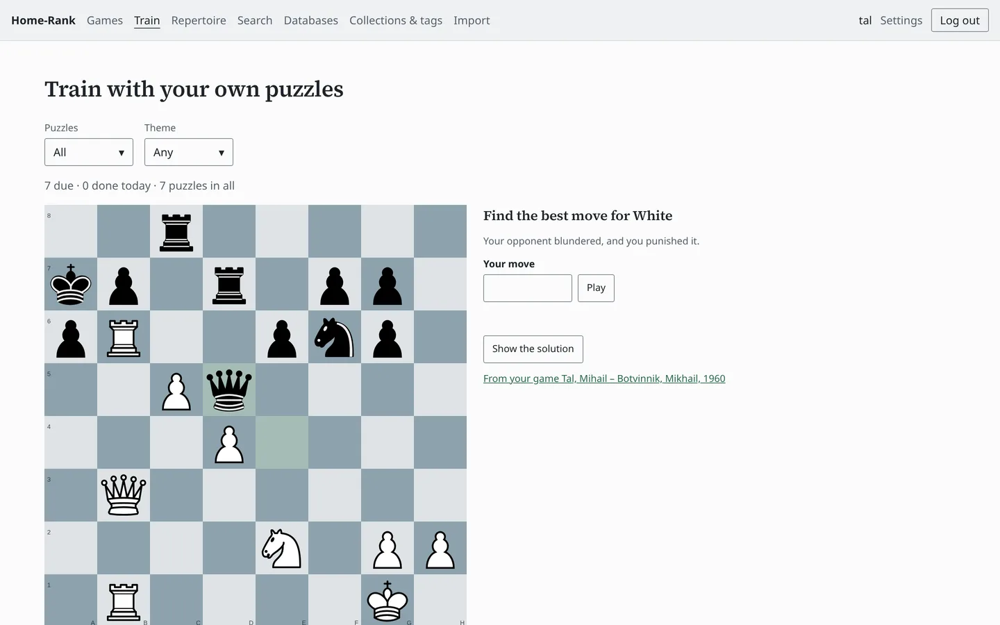
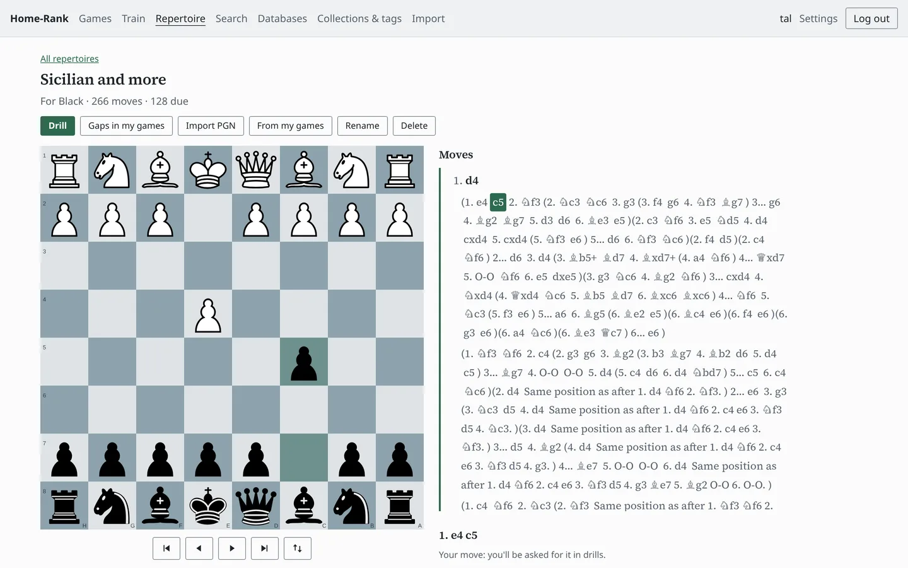
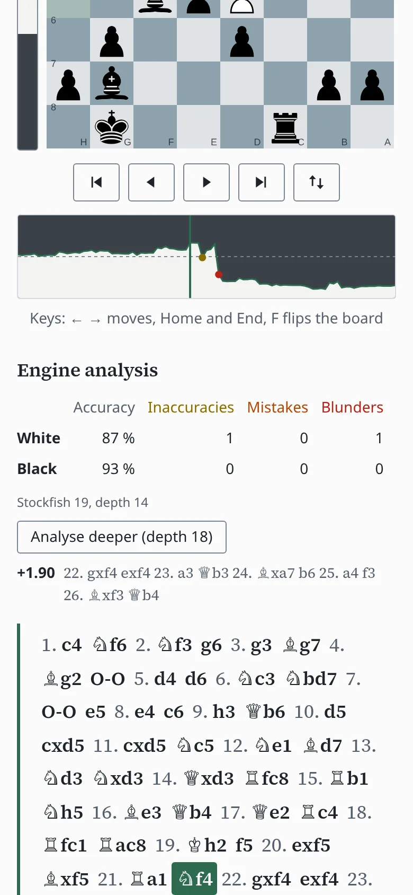
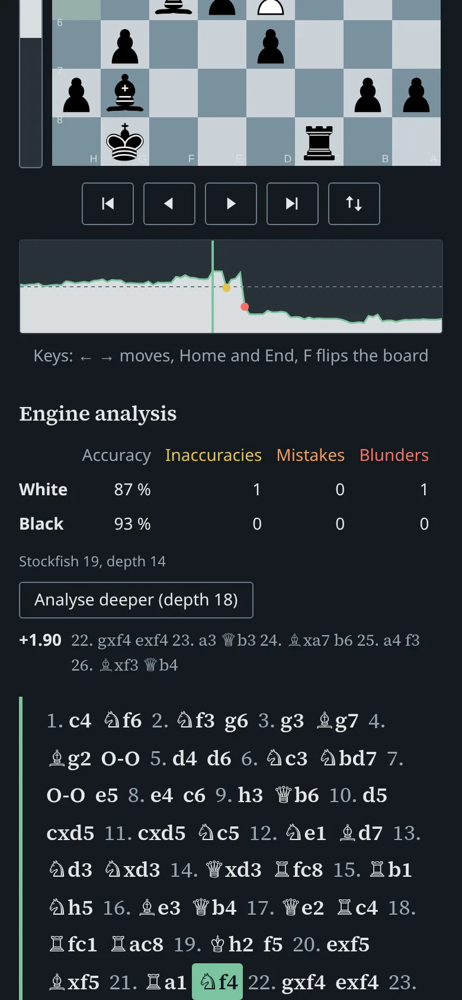

# Home-Rank

A self-hosted chess database and training app: your games, analysed overnight, turned into your
personal training plan.

Home-Rank stores your games, syncs them from Lichess and Chess.com, analyses them with Stockfish in
the background, and builds tactics puzzles and opening drills from your own mistakes. It can also
import large reference databases such as Lumbra's GigaBase for position search and an opening
explorer.

> **Status:** early development. What works so far:
>
> - importing your games from PGN files, with duplicates skipped;
> - a game list to search and filter by player, your side and result, opening, time control,
>   date, tags and collections;
> - a viewer with the moves set like a chess book, figurines, variations and comments;
> - tags and collections, and PGN export of one game, a selection or a collection;
> - syncing your games from Lichess and Chess.com, every few hours or at the press of a button;
> - analysis by Stockfish: an evaluation bar and graph, inaccuracies, mistakes and blunders, and
>   each player's accuracy, computed like on Lichess; new games are analysed automatically.
> - training with puzzles from your own games: positions where you or your opponent missed a
>   winning move, repeated with spaced repetition (FSRS) until they stick.
> - reference databases such as Lumbra's GigaBase (millions of games, imported from compressed
>   PGN), position search across your games and them, and an opening explorer comparing both.
> - opening repertoires for White and Black: built on the board, imported from PGN (a course or a
>   Lichess study) or started from what you play in your games; a report of where your games
>   left them; and drills of your moves, card by card or whole lines, with spaced repetition.
> - playing openings out against a bot, from any position: Maia, which plays like people of a
>   chosen rating, or Stockfish at a limited strength; with or without a clock, a note where
>   the game left your repertoire, and the game saved to your games if you like.
> - every page works on a phone, with the keyboard alone and with screen readers, in a light and
>   a dark theme.
>
> Next: annotating your own games, and live engine analysis on the board.

## Screenshots

<picture>
  <source media="(prefers-color-scheme: dark)" srcset="docs/screenshots/viewer-dark.webp">
  
</picture>

Tal's sixth game against Botvinnik, World Championship 1960, analysed by Stockfish: the moment
of 21… ♘f4.

<picture>
  <source media="(prefers-color-scheme: dark)" srcset="docs/screenshots/train-dark.webp">
  
</picture>
<picture>
  <source media="(prefers-color-scheme: dark)" srcset="docs/screenshots/repertoire-dark.webp">
  
</picture>

Puzzles from your own games, and a repertoire for Black started from the games played with it.




On a phone, in both themes. (The games are Mikhail Tal's, from
[PGN Mentor](https://www.pgnmentor.com/).)

## Quick start

With Docker and the Compose plugin installed:

```sh
mkdir home-rank && cd home-rank
curl -fLO https://github.com/januhrhammer/Home-Rank/releases/latest/download/compose.yaml
curl -fL -o .env.example https://github.com/januhrhammer/Home-Rank/releases/latest/download/env.example
cp .env.example .env   # then fill in the four required values at the top
docker compose up -d
docker compose exec web python manage.py createsuperuser
```

Then open port 8000 of that machine in your browser and log in. Enter the names you play under
in **Settings**, then upload a PGN file of your games under **Import**.
[docs/self-hosting.md](docs/self-hosting.md) explains each step, configuration and updates.

## Development

See [docs/development.md](docs/development.md).

## Contributing

Contributions are welcome: see [CONTRIBUTING.md](CONTRIBUTING.md). Please report security
problems privately, as described in [SECURITY.md](SECURITY.md).

## Licence

[AGPL-3.0-or-later](LICENSE). [ADR 0002](docs/adr/0002-license.md) explains why.
